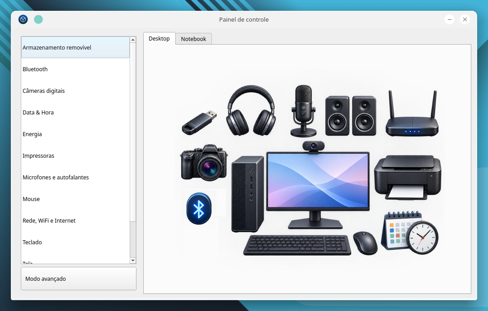

<div align="center">


# Painel de Controle

A visual control panel for KDE Plasma: click the part of the computer you want to configure.

[](https://github.com/mainuan/painel-de-controle/actions/workflows/ci.yml)
[](https://github.com/mainuan/painel-de-controle/releases/latest)


[Português](README.md) · **English**

</div>

---

<p align="center"></p>


## About

Painel de Controle ("Control Panel") shows a picture of a desktop computer and a laptop. Clicking a part of the picture (mouse, keyboard, display, speakers, network, printer, camera…) or the matching entry in the side list opens the related Plasma settings modules through `kcmshell6`. The Webcam entry starts `guvcview`. **Advanced Mode** opens the full System Settings.

## Features

- Shortcuts to mouse, keyboard, touchpad, audio, date and time, network, display, power, printers, removable storage, Bluetooth, digital cameras and webcam settings.
- The panel hides while a settings window is open and returns when it closes.
- Keyboard shortcut **Meta+I**.

## Installation

Preinstalled on the Mainuan ISO. To install manually, download `painel-de-controle_1.1.1_amd64.deb` and `SHA256SUMS` from the [latest release](https://github.com/mainuan/painel-de-controle/releases/latest):

```bash
sha256sum --check --ignore-missing SHA256SUMS
sudo apt install ./painel-de-controle_1.1.1_amd64.deb
```

## Usage

Run `painel-controle` (no options) or open **Control Panel** from the menu. Manual page: `man painel-controle`.

## Technical information

| Item | Value |
|---|---|
| Language | C++17 |
| Toolkit | Qt 6 Widgets, KF6 KI18n, qmake6 |
| Base | Kubuntu 26.04 LTS, KDE Plasma 6.6 |
| Package | `painel-de-controle` (Debian, `amd64`) |

## Build and test

```bash
mkdir build && cd build
qmake6 ../PainelControle.pro && make -j2
cd .. && QT_QPA_PLATFORM=offscreen tests/run-i18n-tests.sh "$PWD/build/tests"
dpkg-buildpackage -us -uc -b
```

Full CI sequence: [`.github/workflows/ci.yml`](.github/workflows/ci.yml).

## Translations

33 languages, English as the source language. See [docs/i18n/README.md](docs/i18n/README.md).

## Contributing

Use [Issues](https://github.com/mainuan/painel-de-controle/issues) and pull requests to `main`.

## Credits

Natanael Barbosa Santos ([@natanael-art](https://github.com/natanael-art)), author; Rafael Ruscher ([@ruscher](https://github.com/ruscher)), translation, Debian packaging and maintenance.

## License

This repository has **no license file**, and the sources carry no license notice. Until the authors publish one, all rights are reserved to them (see [`debian/copyright`](debian/copyright)).
