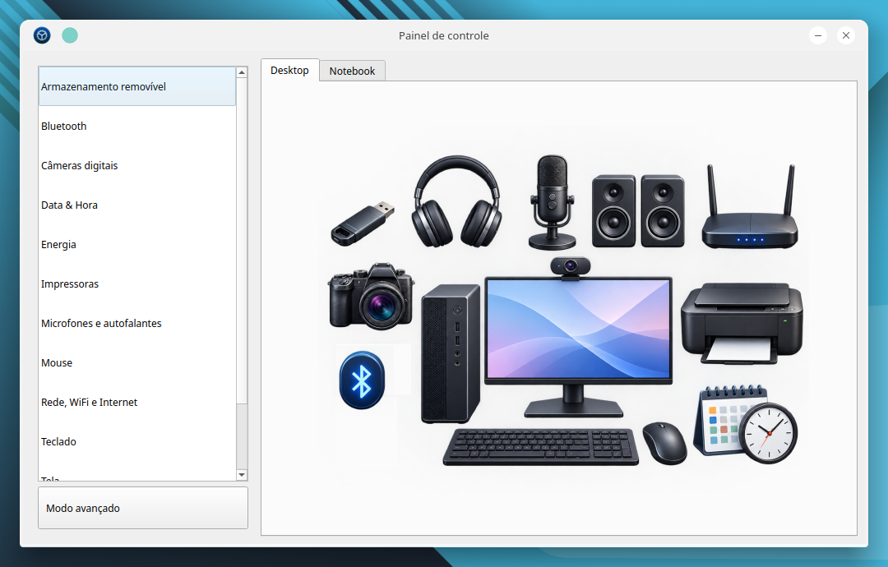

<div align="center">


# Painel de Controle

Painel de controle visual para o KDE Plasma: clique na parte do computador que quer configurar.

[](https://github.com/mainuan/painel-de-controle/actions/workflows/ci.yml)
[](https://github.com/mainuan/painel-de-controle/releases/latest)
[](LICENSE)


**Português** · [English](README.en.md)

</div>

---

<p align="center"></p>


## O que é

O Painel de Controle mostra a imagem de um computador de mesa e de um notebook. Clicar numa parte da imagem (mouse, teclado, tela, alto-falantes, rede, impressora, câmera…) ou no item correspondente da lista lateral abre os módulos de configuração do Plasma ligados a ela, pelo `kcmshell6`.

É um atalho para quem prefere achar as configurações pelo dispositivo, não pelo nome do módulo. O **Modo avançado** abre as Configurações do Sistema completas.

## Funcionalidades

| Item | Módulos abertos |
|---|---|
| Mouse | `kcm_mouse` |
| Teclado | `kcm_keyboard` |
| Touchpad (notebook) | `kcm_touchpad` |
| Microfones e alto-falantes | `kcm_pulseaudio`, `kcm_audiocd` |
| Data e hora | `kcm_clock`, `kcm_regionandlang`, `kcmspellchecking`, `kcm_nighttime` |
| Rede, Wi-Fi e Internet | `kcm_networkmanagement`, `kcm_proxy`, `kcm_cellular_network`, `kcm_netpref` |
| Tela | `kcm_kscreen`, `kcm_nightlight`, `kcm_kgamma`, `kcm_touchscreen`, `kcm_wacomtablet`, `kcm_tablet` |
| Energia | `kcm_energyinfo`, `kcm_mobile_power` |
| Impressoras | `kcm_printer_manager` |
| Armazenamento removível | `kcm_device_automounter`, `kcm_solid_actions` |
| Bluetooth | `kcm_bluetooth` |
| Câmeras digitais | `kcm_kamera` |
| Webcam | abre o `guvcview` |

- A janela do painel se esconde enquanto a janela de configuração está aberta e volta quando ela é fechada.
- O título da janela de configuração segue o idioma da sessão.
- Atalho de teclado **Meta+I**.

## Instalação

O Painel de Controle já vem instalado na ISO do Mainuan. Para instalar manualmente, baixe `painel-de-controle_1.1.1_amd64.deb` e `SHA256SUMS` da [última release](https://github.com/mainuan/painel-de-controle/releases/latest) e, na pasta dos dois arquivos:

```bash
sha256sum --check --ignore-missing SHA256SUMS
sudo apt install ./painel-de-controle_1.1.1_amd64.deb
```

Alguns módulos vêm de pacotes opcionais. Para ter todos: `sudo apt install kamera kde-config-tablet kgamma kio-audiocd kio-extras`.

## Uso

Abra **Painel de controle** no menu de aplicativos (categoria Configurações), use **Meta+I** ou execute:

```bash
painel-controle
```

O comando não tem opções. Página de manual: `man painel-controle`.

| Variável | Uso |
|---|---|
| `PAINEL_CONTROLE_LOCALEDIR` | diretório extra com catálogos `<idioma>/LC_MESSAGES/painel-controle.mo`, para rodar a partir da pasta de build |

## Informações técnicas

| Item | Valor |
|---|---|
| Linguagem | C++17 |
| Toolkit | Qt 6 Widgets, KF6 KI18n; build com qmake6 |
| Base | Kubuntu 26.04 LTS, KDE Plasma 6.6 |
| Pacote | `painel-de-controle` (Debian, `amd64`); executável `painel-controle` |
| Dependências principais | `systemsettings`, `libkf6kcmutils-bin` (`kcmshell6`); recomenda `plasma-nm`, `plasma-pa`, `powerdevil`, `print-manager`, `bluedevil`, `kscreen`, `guvcview` e outros |
| Arquitetura | amd64 |

Desde a 1.1.1 o atalho do menu pertence a este pacote (`Breaks`/`Replaces: mainuan-desktop-defaults (<< 2026.11.17.1)`).

## Compilação e testes

Num Kubuntu 26.04, com as dependências de [`debian/control`](debian/control). São os comandos que o [CI](.github/workflows/ci.yml) executa, sobre o pipeline Debian compartilhado da organização:

```bash
git clone https://github.com/mainuan/painel-de-controle.git
cd painel-de-controle
sudo apt-get build-dep --no-install-recommends ./

po/i18n.sh check-pot && po/i18n.sh validate
mkdir build && cd build
qmake6 ../PainelControle.pro "QMAKE_CXXFLAGS+=-Wall -Wextra" && make -j2
cd .. && QT_QPA_PLATFORM=offscreen tests/run-i18n-tests.sh "$PWD/build/tests"   # pt_BR, en e C
dpkg-buildpackage -us -uc -b
lintian --fail-on error ../painel-de-controle_1.1.1_amd64.deb
```

O CI falha com qualquer aviso de compilação no código do projeto e se o teste de tradução for pulado. Depois, instala o `.deb` num Ubuntu 26.04 limpo, confere que o `kcmshell6` lista todos os módulos que o painel abre, inicia a janela real (offscreen) e remove e expurga o pacote. A Release só é publicada por tag `v<versão>` igual à de `debian/changelog` e nunca substitui uma Release existente.

## Traduções

A interface está em 33 idiomas (catálogos em [`po/`](po), inglês como idioma-fonte): ar, bn, cs, da, de, el, es, fa, fi, fr, he, hi, hu, id, it, ja, ko, nb, nl, pl, pt, pt_BR, ro, ru, sv, sw, th, tr, uk, ur, vi, zh_CN e zh_TW.

Como traduzir: [docs/i18n/README.md](docs/i18n/README.md).

## Contribuição

Relate problemas em [Issues](https://github.com/mainuan/painel-de-controle/issues) e envie pull requests para `main`; cada PR passa pelo CI completo.

## Créditos

- **Natanael Barbosa Santos** ([@natanael-art](https://github.com/natanael-art)), autor
- **Rafael Ruscher** ([@ruscher](https://github.com/ruscher)), tradução, empacotamento Debian e manutenção

## Licença

GNU General Public License, versão 2 (GPL-2.0). Texto completo em [`LICENSE`](LICENSE).
